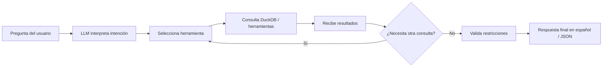

# Documentación técnica: arquitectura, calidad de datos y aprendizajes

## 1. Arquitectura

### Decisiones fundamentales
- **Por qué Python y DuckDB:** DuckDB corre embebido en proceso (sin servidor ni Docker), lee CSV directamente con tipos estrictos y ejecuta consultas analíticas SQL (`JOIN`, `GROUP BY`, `FILTER`, funciones de ventana) en milisegundos.
- **Por qué herramientas SQL y no RAG tradicional:** las preguntas del gerente son principalmente agregaciones, tasas, rankings y filtros temporales sobre datos tabulares. Un RAG sobre fragmentos de texto no puede sumar pedidos ni calcular tasas exactas; el SQL sobre DuckDB garantiza cifras reproducibles.
- **Por qué no entrenamos un modelo:** la tarea no requiere ajustar pesos ni aprender un dominio nuevo de lenguaje; la exactitud depende de consultar la base actualizada en tiempo de inferencia mediante *function calling*.

### Enfoque: sistema agéntico con LLM vs. ML clásico
- **Por qué no ML clásico:** la consigna no pide entrenar un modelo predictivo (no hay regresión, clasificación, *forecasting* ni entrenamiento supervisado), sino responder preguntas en lenguaje natural sobre datos existentes. El valor está en la **interpretación de preguntas, uso de herramientas y *grounding* en datos**.
- **Qué lo hace agéntico (autonomía limitada y controlada):** no es solo un chatbot con LLM. El modelo interpreta la intención, decide qué herramienta usar, construye y ejecuta consultas, observa resultados, evalúa si necesita nuevas consultas, valida restricciones (por ejemplo, el contrato JSON en recomendaciones) y recién entonces responde. Esa autonomía es acotada: solo usa herramientas permitidas, SQL validado por AST en solo lectura, límite configurable de llamadas al LLM con mecanismos de cierre controlado y manejo de errores, y validación de evidencias.

### Flujo del agente y *function calling*
1. `app/agent.py` recibe la pregunta (CLI o `answer_question()`), detecta si solicita recomendaciones de sucursales (`is_recommendation_request()`) y construye el historial inicial; el `system_prompt` instruye responder siempre en español sin rechazar consultas por idioma.
2. `app/llm.py` (`GeminiBackend` u `OpenRouterBackend`, ambos heredando de `_BaseResilientBackend`) envía el `system_prompt` (esquema + definiciones de métricas), el historial y las declaraciones de herramientas (`TOOL_SPECS` de `app/tools.py`). Los reintentos internos de ambos SDK están desactivados (`attempts=1` y `max_retries=0`) para controlar timeouts (`12 s` por intento), presupuesto total (`60 s` por pregunta) y trazabilidad desde un único lugar.
3. Si el modelo solicita herramientas, `ToolBox` (`app/tools.py`) las ejecuta sobre una conexión DuckDB de solo lectura (`enable_external_access=false`, `lock_configuration=true`, máx. `100` filas, timeout `15 s`, máx. `12` llamadas por pregunta). Toda consulta en `run_sql` pasa antes por `app/sql_guard.py`, que parsea el AST con `sqlglot` y rechaza todo lo que no sea una única sentencia `SELECT`/`WITH` sobre las tablas y vistas autorizadas.
4. Los resultados vuelven al modelo en el historial hasta obtener una respuesta final en texto o, en recomendaciones, una llamada validada a `submit_recommendations` (array JSON con llaves exactas `sucursal_id`, `motivo`, `evidencia`, `accion_sugerida` y sucursales existentes).
5. `eval/run.py` ejecuta conjuntos `.jsonl` reutilizando `Agent.ask()`, evalúa con `eval/scoring.py` (sin LLM juez) y guarda `results.jsonl`, `summary.json` y `report.md`.

### Revisión de separación, seguridad y dependencias
- **Separación de responsabilidades:** datos (`audit_data.py`, `prepare_data.py`, `db.py`), configuración/proveedor (`config.py`, `llm.py`), seguridad y herramientas (`sql_guard.py`, `tools.py`), agente (`prompts.py`, `agent.py`, `check_models.py`) y evaluación (`scoring.py`, `run.py`).
- **Configuración de proveedores:** `LLM_PROVIDER=gemini|openrouter` exige únicamente la clave del proveedor activo. El fallback entre modelos (`GEMINI_FALLBACK_MODELS`) opera dentro de Gemini directo (excluyendo `gemini-3.7-flash`); no existe fallback automático entre Gemini directo y OpenRouter para evitar mezclar credenciales personales con las de evaluación.
- **Dependencias (`requirements.txt`):** `duckdb`, `pytest`, `google-genai`, `openai`, `python-dotenv`, `sqlglot`. Todas se utilizan directamente.
- **Oportunidad de simplificación observada (sin refactorizar):** el `system_prompt` incluye el esquema completo de tablas y vistas en cada turno (~2.500 tokens de entrada base); mover parte a `get_schema` bajo demanda reduciría tokens, a costa de un turno adicional por pregunta.

## 2. Calidad de datos

- **Auditoría inicial (`python -m app.audit_data`):** ejecutada en solo lectura sobre `data/raw/` (120 sucursales, 9.658 filas de ventas, 6.845 quejas, 36 capacitaciones).
- **Quejas duplicadas:** 199 copias exactas eliminadas → **6.646 quejas únicas** (0 conflictos de `queja_id` con contenido distinto).
- **Pedidos negativos y extremos:** 3 registros negativos (`-5`, `-44`, `-14`) y 5 registros de `99999` (> 10× mediana de su sucursal) se conservan como fila pero pasan a `pedidos = NULL` en `data/processed/ventas_diarias.csv`. Los otros 39 atípicos moderados (incluidos `357`, `526`, `703`) se conservan sin cambios. Los valores originales y motivos quedan en `ventas_diarias_calidad.csv` y `data/quality/transformations_log.csv`.
- **Sucursales nuevas:** 6 sucursales abrieron entre el 16 y el 17 de marzo de 2026 (13–14 días operativos). No se imputan días previos a la apertura como días sin ventas y las vistas calculan `pedidos_por_dia_operativo` para evitar comparaciones sesgadas por volumen acumulado.
- **Capacitaciones y sesgo de selección:** de las 120 sucursales, 36 recibieron capacitación el `2026-02-09` (21 `por_desempeno`, 15 `aleatorio`) y 84 no figuran en `capacitaciones.csv` (`sin_capacitar`). Antes de esa fecha, las `por_desempeno` ya tenían una tasa de `3.49` quejas/1.000 pedidos frente a `2.15` de las asignadas aleatoriamente (y `1.91` de las no capacitadas). Por ello, el grupo `aleatorio` corresponde a un método de asignación entre sucursales capacitadas (no debe confundirse con el grupo no capacitado), y una comparación antes/después **no demuestra causalidad**.

## 3. Dificultades y aprendizajes

- **Restricciones de Gemini directo:** durante las pruebas, `gemini-3.8-flash` y `gemini-3.6-flash` presentaron errores `503`/`504` intermitentes; además, los reintentos internos del SDK se sumaban a los propios. Desactivar los reintentos del SDK y aplicar fallback hacia `gemini-3.5-flash-lite` estabilizó las pruebas.
- **Incorporación de OpenRouter:** permitió ejecutar evaluaciones completas con `google/gemini-3.8-flash` sin fallos de disponibilidad ni límites de cuota gratuita.
- **Falsos negativos en P06 y P10:** en la primera corrida real (V1, 8/10), el agente respondió bien ambas preguntas, pero `eval/scoring.py` falló al concatenar la lista principal de P06 con la explicación numerada posterior y al exigir `82%` y `"baño"` exactos frente a `81.67% (49 de 60)` y `"baños"`. Corregir exclusivamente el evaluador (sin tocar el agente) subió V1 recalculada a 10/10, confirmando la importancia de separar errores del LLM de errores del evaluador.
- **Criterios textuales deterministas:** evitan el costo y no-determinismo de un LLM juez, pero no evalúan fluidez ni negaciones complejas alejadas del término (> 3 palabras).

## 4. Limitaciones y mejoras futuras

- **Muestras pequeñas en recomendaciones:** sucursales nuevas como `S015` o `S076` (13–14 días operativos) alcanzan tasas altas con pocas quejas; conviene ponderar o filtrar por volumen mínimo en criterios de priorización.
- **Generalización:** el 100% obtenido corresponde a las 18 preguntas evaluadas y no garantiza igual desempeño ante preguntas abiertas o ambiguas no vistas.
- **Mejoras futuras:** incorporar evaluación semántica opcional para respuestas textuales extensas, caché de esquema/consultas frecuentes para bajar tokens de entrada y una interfaz web ligera si se requiere uso por gerentes no técnicos.
